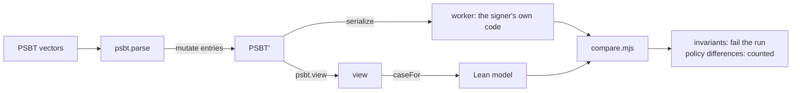
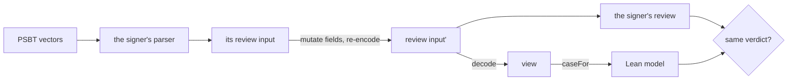

# How a signer's code reaches the model

The Lean model never links against a signer. Each signer runs its own code, the model runs as a separate
process, and Node scripts in `adapters/` hand both the same transaction and compare what comes back. This
page follows that path: where the files are, what each step passes on, and what the proofs do and do not
cover along the way.

## Where things are

```
SignerSpec/Model.lean      the model: Tx, Env, review, display, sign
SignerSpec/Theorems.lean   proofs about those same definitions
SignerSpec/Sessions.lean   what signatures commit to, and the fee of what is assembled from them
SignerSpec/Notation.lean   how amounts and scripts are written on screen, one to one
SignerSpec/Checksums.lean  the real address checksums, used by the executable only
SignerSpec/Sighash.lean    the BIP143 and BIP341 digests, and SigValid derived from them
tests/Notation.lean        that notation against published address vectors
SignerSpec/Message.lean    how a message to sign is shown, one to one for a reader
tests/Sighash.lean         those digests against the BIP143 and BIP341 vectors
SignerSpec/Txid.lean       the serialization a txid hashes, and Bound derived from it
tests/Txid.lean            that serialization and txid against raw mainnet transactions
tests/Message.lean         the message display on the cases that decide it
SignerSpec/Address.lean    an address read back to its script, and only the screen's string
tests/Address.lean         that reading against the BIP350 and base58check vectors
SignerSpec/Mnemonic.lean   BIP39 words and entropy, the last word, SeedQR (Wordlist.lean: the words)
tests/Mnemonic.lean        those against the BIP39 and SeedQR vectors
SignerSpec/Psbt.lean       a PSBT's maps as bytes, and that faithful readers agree
tests/Psbt.lean            that against PSBT vectors
SignerSpec/Multisig.lean   a sortedmulti script, and what it and its P2WSH output bind
tests/Multisig.lean        that script against the BIP67 vectors
SignerSpec/OrD.lean        an or_d wallet's script, and what it and its P2WSH output bind
tests/OrD.lean             that reading against bitwasm-signer's or_d vectors
Main.lean                  the model as an executable (build: .lake/build/bin/signer-spec)
adapters/
  bitcoin.mjs              BIP32, scripts, previous transactions, from node:crypto (no signer's code)
  model.mjs                test seeds and wallets; caseFor(): a view -> the model's JSON case; startModel()
  psbt.mjs                 PSBT v0 parse/serialize; view(): what a PSBT says, in the model's terms
  compare.mjs              the invariant comparison: PSBT-level mutations, invariants, policy differences
  <signer>.mjs             one per signer: which wallets to hold, and how to start its worker
  seedsigner.py            worker running SeedSigner's PSBTParser
  krux.py                  worker running Krux's PSBTSigner under CPython
  specter.py               worker running Specter DIY's WalletManager.sign_psbt under CPython
  coldcard.py              worker driving Coldcard's desktop simulator over its USB protocol
  coconut/                 worker over Coconut Vault's coconut_lib, in Dart
  bitcoinjs-worker.mjs     worker over bitcoinjs-lib, in Node
  core-worker.mjs          worker over a regtest bitcoind's wallet RPCs
  wally.py                 worker over libwally-core's Python bindings
  rust-bitcoin/            worker over rust-bitcoin, in Rust (built into build/rust-bitcoin-review)
  bitwasm.mjs              bitwasm-signer: the exact comparison, through its fixed-layout plan
  plan.mjs                 its plan decoded and encoded, the mutations on plans, and its parser
third_party/               the signers and libraries, at the commits Makefile pins (make deps)
build/                     their Python environments and the compiled Dart worker
```

## The model's side

`Main.lean` reads one JSON case per line and prints one verdict per line. It calls `review` from
`Model.lean`, the definition the theorems are about, so a verdict is the proved model's answer and not a
re-implementation of it.

A case is a transaction as a signer sees it, with the cryptography already answered:

```json
{
  "network": 0, "fingerprint": 1942346250,
  "inputs":  [{"amount": "100000", "spk": "0014…", "key": {"fp": 1942346250, "path": [2147483732, …]},
               "sighash": 1, "ws": null, "txid": "3b…",
               "prev": {"txid": "3b…", "out": {"amount": "100000", "spk": "0014…"}}}],
  "outputs": [{"amount": "60000", "spk": "0014…", "key": null}],
  "owns":    [{"fp": 1942346250, "path": [2147483732, …], "spk": "0014…", "ws": null}],
  "wallet":  null
}
```

- `key` is the PSBT's claim that an input or output is ours. The model does not trust it.
- `owns` lists the claims that hold: our seed at that path makes that script. The model's `Env.owns` is
  true exactly for these. `adapters/bitcoin.mjs` computes them from the seed, never the signer under test.
- `txid` is the transaction the input spends. `prev` is its non_witness_utxo as parsed by `bitcoin.mjs`:
  `null` when absent, else the txid it hashes to and its output at prev_vout (`null` if it has none). The
  model's `PrevTx.of` decides from these whether it matches: txid, amount and script all have to agree.
- `wallet`, when a multisig is registered, lists which inputs' witness scripts and outputs' scripts belong
  to it, and on which chain, and for an input our other key in the wallet if it holds us twice. The
  adapters compute it from the cosigners' seeds.

The verdict is one of:

- `{"ok": {"totalIn", "totalOut", "fee", "willSign": [bool], "owners": [0|1|2]}, "sigs": [{input, fp, path}]}`,
  where owners are external, change and self, and `sigs` is what `sign` produces after that review
- `{"error": …}`, naming the model's `Error`: `FORMAT`, `NOT_OURS`, `NOTHING_TO_SIGN`, `SIGHASH`,
  `SCRIPT`, `PREVTX_MISSING`, `PREVTX_MISMATCH`, `FEE` or `WALLET`
- `{"fatal": …}`, when a case cannot be read

A line `{"render": {"network": "main"|"test"|"regtest", "spk": hex}}` instead gets `{"address": …}`, what
`Notation.lean` writes for that script, with the checksums of `Checksums.lean`. A line `{"message": hex}`
gets `{"kind": "text"|"hex", "text": …}`, what `Message.lean` shows for those bytes.

`caseFor(view, network, wallet)` in `model.mjs` builds a case from a *view*:
`{inputs: [{amount, spk, key, sighash, ws, txid, prevInfo}], outputs: [{amount, spk, key}]}`. Getting from a
signer's input to that view is the only part that differs between comparisons.

## The invariant comparison (every signer)



`psbt.mjs` reads the PSBT independently of any signer. `view()` takes as an input's or output's key the
first derivation naming our fingerprint, for the script types the model signs for (see its comment).
Mutations work on the PSBT's key-value maps: derivations, amounts, scripts, previous transactions (removed,
swapped between inputs, or pointed at another output), sighash and witness scripts. The result is
serialized back for the worker. `MUTATIONS="input prev_vout changed"` (names as in `mutators()`) runs only
those, to see what one does on its own.

A worker is a long-running process that speaks one JSON line per request:

- **Request:** `{"psbt": base64, "config": {…}}`. `config` says which wallet to hold, such as a descriptor
  or a script type.
- **Verdict:** `{"error", "detail"}`, or `{"ok": {"input", "spend", "change", "fee", "outputs": [{"index",
  "verified"}], "warnings": […], "addresses": [{"index", "address"}]}}`. These are the figures the signer's
  screens would show; `addresses` is optional, and each is checked against the model's rendering on the
  signer's network (`network` in its adapter, "main" by default).

Each worker calls the project's real code and follows what its screens do around it.

| signer | worker | calls | follows |
|---|---|---|---|
| SeedSigner | `seedsigner.py` | `PSBTParser` | `PSBTChangeDetailsView`'s change verification |
| Specter DIY | `specter.py` | `WalletManager.sign_psbt`, with the device modules stubbed as Specter's native tests stub them | every prompt accepted, then the confirmation screen's change, fee and warnings |
| Coldcard | `coldcard.py` | its firmware in the desktop simulator, headless, asked over USB for the approval screen's text (`STXN_VISUALIZE`) | that screen's amounts, change and warnings; it shows no input total, so it is taken as sent + change + fee |
| Krux | `krux.py` | `PSBTSigner`, with the device modules stubbed as Krux's own tests stub them | the sign page's warnings, then `add_signatures()` |
| Coconut Vault | `coconut/bin/review.dart` | coconut_lib | the app's `canSign` checks, the confirmation screen's output sorting, then signing |
| Bitcoin Core | `core-worker.mjs` | `walletprocesspsbt`, `decodepsbt` on regtest | none: the fee `decodepsbt` reports stands for the screen |
| libwally-core | `wally.py` | `psbt_sign_bip32`, `psbt_get_input_best_utxo` | none: a library has no fee function, so the sum a wallet on it would make stands for one |
| rust-bitcoin | `rust-bitcoin/src/main.rs` | `Psbt::sign`, `Psbt::fee`, `Address::from_script` | none: the fee it computes stands for a screen; a panic is reported as a refusal |
| bitcoinjs-lib | `bitcoinjs-worker.mjs` | `Psbt`: `signAllInputsHD`, `finalizeAllInputs`, `getFee` | none: a library has no screen, so the fee it computes stands for one |

`compare.mjs` runs the model on the same PSBT's view and reports two things apart.

- **Invariants**: what any signer must keep for what it lets the user approve, listed in the README.
  Breaking one fails the run.
- **Policy differences**: counted with a reason, such as which path rule made the model call an output
  external. These are not failures.

## The exact comparison (signers that report the model's decisions)



Some signers report their review's decisions as data: the error, or which inputs they sign, each output's
owner and the totals. For these, every verdict must equal the model's. The adapter decodes the signer's
own review input into a view and mutates that input directly, so the mutations reach fields a PSBT
cannot express. Byte-level faults, which the model does not describe, must come back as `FORMAT`.

bitwasm-signer is compared this way by `bitwasm.mjs`. Its parser produces a fixed-layout plan, and its
`signer.wasm` reviews that plan. The run covers mainnet, a multisig registered, another multisig
registered, an or_d wallet that reuses our seed on its recovery path registered, and testnet. When review succeeds, its `display()` is checked too: the fee and spend
review settled, each output's amount, and its text, an address exactly as `Notation.lean` renders the
script, or hex of OP_RETURN data or of a script with no address.

Signing is checked against guarantee 4 on a second instance, through the module's raw `signer_sign`
rather than the JS wrapper's own flag. It must refuse with no passing review, refuse a plan that differs
from the one reviewed, and refuse a second time on one review. Otherwise it must sign exactly the inputs and keys
the model's `sigs` names, each signature verifying under the key derived for that path over
the BIP143 or BIP341 digest of the reviewed transaction, which `bitcoin.mjs` computes with node:crypto.

Message review is checked too: random bytes, mostly spaces, letters and the edges of printable ASCII,
must be shown with the kind and text the model's `message` request gives.

## What the proofs cover on this path

The theorems hold for `review`, `display` and `sign` in `Model.lean`, and so for every verdict the
executable prints. They do not reach the adapters or the signers. That a signer matches the model is
tested, and the inputs the model is given rest on code that is not proved:

- `bitcoin.mjs`: key derivation, scripts, previous transactions, sighash digests, signature verification
- `psbt.mjs`: what a PSBT says
- `plan.mjs`: decoding a plan

These checks are what stand behind that code:

- `bitcoin.mjs` is shared by every comparison.
- `psbt.mjs` and `plan.mjs` are two independent routes from the same vector to the model. On every
  unmutated vector they give the same verdict.

## Adding a signer

1. Pin it in `Makefile` (`deps`) and fetch it into `third_party/`.
2. Write a worker in whatever language runs its code. It reads requests, calls the signer's own review
   and signing, and prints a verdict in the shape above. Mirror what its UI checks around that code; do
   not re-implement its policy.
3. Write `adapters/<name>.mjs`, calling `compare()` with a `command` that starts the worker and one config
   per kind of wallet it holds, each with the `wallet` the model should be given.
4. Add `check-<name>` to `Makefile`. Before trusting a clean run, plant a bug in the worker's output (skip
   a verification, shift the fee) and check that an invariant catches it.
5. If the signer can report its decisions as data, add an exact comparison too.
